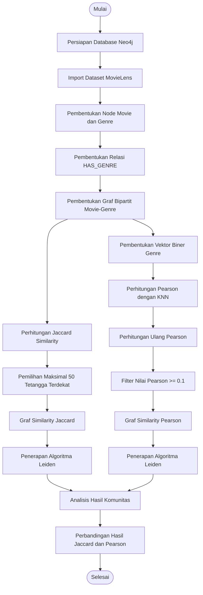

# Analisis Perbandingan Jaccard Similarity dan Pearson Correlation pada Community Detection Film Menggunakan Algoritma Leiden

## 📌 Deskripsi Proyek

Proyek ini bertujuan untuk melakukan pengelompokan film (*Community Detection*) berdasarkan kemiripan genre menggunakan algoritma Leiden pada Neo4j Graph Data Science.

Proyek ini membandingkan dua metode pengukuran kemiripan, yaitu:

- **Jaccard Similarity**: Mengukur tingkat kemiripan antara dua film berdasarkan irisan dan gabungan genre yang dimiliki.
- **Pearson Correlation**: Mengukur korelasi antara dua film berdasarkan representasi vektor biner genre.

Hasil perhitungan kedua metode tersebut digunakan untuk membentuk graf kemiripan film (*Similarity Graph*). Selanjutnya, algoritma Leiden diterapkan secara terpisah pada masing-masing graf untuk menemukan komunitas film.

## 🎯 Tujuan

1. Merepresentasikan data film dan genre dalam bentuk graf.
2. Menghitung kemiripan antarfilm menggunakan Jaccard Similarity dan Pearson Correlation.
3. Membentuk graf berdasarkan hubungan kemiripan antarfilm.
4. Menerapkan algoritma Leiden untuk mengidentifikasi komunitas film.
5. Membandingkan hasil pembentukan komunitas menggunakan kedua metode kemiripan.

## 🛠️ Teknologi yang Digunakan

- **Neo4j** – Database berbasis graf.
- **Cypher Query Language** – Bahasa query untuk mengelola dan menganalisis data graf.
- **Neo4j Graph Data Science (GDS)** – Library untuk pemrosesan graf, perhitungan similarity, dan community detection.
- **MovieLens Dataset** – Dataset film dan informasi genre.

## 📊 Alur Penelitian

Berikut merupakan tahapan proses yang dilakukan dalam proyek ini.



## 📁 Struktur Repository

```text
Movie-Community-Detection/
│
├── README.md
│
├── data/
│   └── movies.csv
│
└── queries/
    └── UTS Graf Kelompok 11.cypher
```

## ⚙️ Persyaratan

Sebelum menjalankan proyek, pastikan sudah tersedia:

- Neo4j Database.
- Neo4j Graph Data Science (GDS) Library.
- Dataset MovieLens (File `movies.csv`).

## 🚀 Tahapan Implementasi

### 1. Persiapan Database

Membuat database baru dengan nama `uts`.

```cypher
CREATE DATABASE uts IF NOT EXISTS;
```

Menggunakan database:

```cypher
:use uts
```

### 2. Import Dataset MovieLens

Memasukkan data film dari file CSV ke dalam database Neo4j.

```cypher
LOAD CSV WITH HEADERS FROM 'file:///movies.csv' AS row
MERGE (m:Movie {movieId: toInteger(row.movieId)})
SET m.title = row.title,
    m.genres = split(row.genres, '|');
```

### 3. Pembentukan Node dan Relasi Genre

Membuat node Genre dan menghubungkannya dengan node Movie menggunakan relasi `HAS_GENRE`.

```cypher
MATCH (m:Movie)
UNWIND m.genres AS genreName
WITH m, genreName
WHERE genreName <> '(no genres listed)'
MERGE (g:Genre {name: genreName})
MERGE (m)-[:HAS_GENRE]->(g);
```

### 4. Pembentukan Graf Bipartit Movie-Genre

Membentuk graf bipartit yang terdiri dari dua jenis node, yaitu Movie dan Genre.

Relasi `HAS_GENRE` menunjukkan hubungan antara film dan genre yang dimilikinya.

Graf ini menjadi dasar untuk menghitung kemiripan antarfilm.

### 5. Perhitungan Jaccard Similarity

Menghitung tingkat kemiripan antarfilm berdasarkan kesamaan genre menggunakan Jaccard Similarity.

Rumus:

$$
J(A,B)=\frac{|A\cap B|}{|A\cup B|}
$$

Keterangan:
- A: Himpunan genre film pertama.
- B: Himpunan genre film kedua.
- Irisan: Genre yang dimiliki kedua film.
- Gabungan: Seluruh genre unik dari kedua film.

Konfigurasi utama:
- Metrik: Jaccard.
- Top K: 50.
- Similarity Cutoff: 0.1.

### 6. Pembentukan Vektor Biner Genre

Setiap film direpresentasikan dalam bentuk vektor biner berdasarkan seluruh genre yang tersedia.

Ketentuan:
- Nilai 1 menunjukkan bahwa film memiliki genre tersebut.
- Nilai 0 menunjukkan bahwa film tidak memiliki genre tersebut.

Vektor ini digunakan sebagai representasi numerik untuk menghitung Pearson Correlation.

### 7. Perhitungan Pearson Correlation

Menghitung kemiripan antarfilm berdasarkan korelasi vektor biner genre menggunakan metode Pearson Correlation. Setiap genre direpresentasikan dengan nilai `1` jika dimiliki film dan `0` jika tidak dimiliki.

Rumus Pearson Correlation:

$$
r_{xy} =
\frac{G \cdot c - n_x \cdot n_y}
{\sqrt{(G \cdot n_x-n_x^2)(G \cdot n_y-n_y^2)}}
$$

Keterangan:
- $r_{xy}$: Nilai korelasi Pearson antara film $x$ dan film $y$.
- $G$: Jumlah seluruh genre dalam dataset.
- $c$: Jumlah genre yang sama-sama dimiliki kedua film.
- $n_x$: Jumlah genre yang dimiliki film $x$.
- $n_y$: Jumlah genre yang dimiliki film $y$.

Konfigurasi KNN pada Neo4j GDS:
- Properti node: `genreVector`.
- Metrik: Pearson.
- Top K: 50.
- Similarity Cutoff: 0.0.

Tahapan perhitungan:
1. Membentuk vektor biner genre untuk setiap film.
2. Menggunakan algoritma KNN dengan metrik Pearson untuk mendapatkan kandidat film yang memiliki kemiripan.
3. Menghitung kembali nilai Pearson Correlation menggunakan rumus di atas.
4. Menyimpan hasil korelasi pada properti relationship `pearson`.
5. Menghapus relationship dengan nilai Pearson `NULL` atau kurang dari `0.1`.

Nilai Pearson Correlation yang telah dihitung ulang digunakan sebagai bobot relationship pada pembentukan graph Pearson dan proses community detection menggunakan algoritma Leiden.

### 8. Pembentukan Graf Similarity

Membentuk dua graf berdasarkan hasil perhitungan kemiripan:

- **Graf Jaccard**: Menggunakan relasi `SIMILAR_JACCARD` dengan bobot `jaccard`.
- **Graf Pearson**: Menggunakan relasi `SIMILAR_PEARSON` dengan bobot `pearson`.

Kedua graf diproyeksikan secara terpisah dengan orientasi relasi tidak berarah (*UNDIRECTED*).

### 9. Community Detection Menggunakan Leiden

Algoritma Leiden diterapkan pada kedua graf secara terpisah.

**Jaccard + Leiden**

Menggunakan graf similarity Jaccard untuk mengelompokkan film berdasarkan bobot kemiripan genre.

Hasil komunitas disimpan pada properti `leidenJaccard`.

**Pearson + Leiden**

Menggunakan graf similarity Pearson untuk mengelompokkan film berdasarkan korelasi vektor biner genre.

Hasil komunitas disimpan pada properti `leidenPearson`.

Konfigurasi utama algoritma Leiden:
- Random Seed: 42.
- Concurrency: 1.
- Maximum Levels: 10.
- Gamma: 1.0.
- Theta: 0.01.

## 📈 Analisis dan Perbandingan Hasil

Setelah proses community detection selesai, dilakukan analisis terhadap hasil pembentukan komunitas dari kedua metode.

Analisis yang dilakukan meliputi:

1. **Jumlah Film dan Komunitas** – Menghitung jumlah film yang berhasil masuk ke dalam graf dan jumlah komunitas yang terbentuk.
2. **Distribusi Ukuran Komunitas** – Mengidentifikasi jumlah film dalam setiap komunitas.
3. **Genre Dominan** – Mengidentifikasi genre yang paling banyak muncul dalam suatu komunitas.
4. **Degree** – Mengidentifikasi film yang memiliki jumlah hubungan terbanyak dengan film lain.
5. **Kohesi Komunitas** – Mengukur proporsi bobot relasi yang menghubungkan film-film dalam komunitas yang sama.
6. **Cross Community** – Membandingkan pembagian komunitas antara hasil Jaccard dan Pearson.

Hasil analisis digunakan untuk mengetahui perbedaan karakteristik komunitas yang dihasilkan oleh kedua metode similarity.

## 🧑‍🤝‍🧑Konsep Top K = 50

Parameter `Top K` menunjukkan jumlah maksimal tetangga terdekat yang dipilih untuk setiap film berdasarkan nilai kemiripannya. Pada penelitian ini, parameter `Top K = 50` diterapkan pada perhitungan Jaccard Similarity maupun Pearson Correlation.

Sebagai contoh, apabila terdapat Film A, sistem akan mencari maksimal 50 film lain yang memiliki nilai kemiripan tertinggi terhadap Film A berdasarkan masing-masing metrik.

- **Pada Jaccard Similarity:** Pemilihan tetangga terdekat didasarkan pada nilai kesamaan himpunan genre antara dua film.
- **Pada Pearson Correlation:** Pemilihan tetangga terdekat didasarkan pada nilai korelasi antara vektor biner genre dua film.

Pemilihan ini bertujuan untuk membatasi jumlah relasi antarfilm sehingga graf tidak terlalu padat. Dengan demikian, setiap film hanya terhubung dengan sejumlah film yang memiliki tingkat kemiripan tertinggi.

KNN digunakan untuk menentukan hubungan tetangga terdekat, bukan untuk menentukan komunitas. Penentuan komunitas dilakukan menggunakan algoritma Leiden berdasarkan graf kemiripan yang telah terbentuk.

**Tahapan penerapan pada masing-masing metode:**

1. **Jaccard Similarity:** Algoritma KNN tidak digunakan pada metode ini. Neo4j GDS Node Similarity digunakan untuk menghitung kemiripan Jaccard sekaligus memilih maksimal 50 tetangga terdekat untuk setiap film. Relasi dengan nilai Jaccard di bawah `0.1` tidak disimpan.
2. **Pearson Correlation:** Algoritma KNN digunakan untuk mencari maksimal 50 kandidat tetangga terdekat berdasarkan metrik Pearson dengan `Similarity Cutoff = 0.0`. Setelah itu, nilai Pearson dihitung kembali menggunakan rumus korelasi Pearson yang diimplementasikan berdasarkan properti genre film. Relasi dengan nilai Pearson `NULL` atau di bawah `0.1` kemudian dihapus.